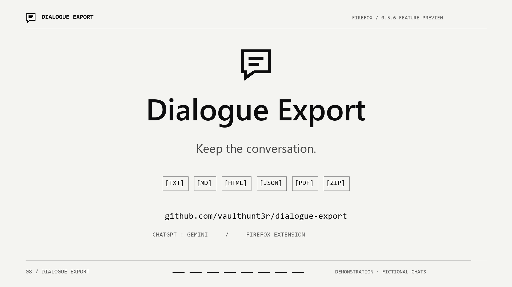

#  Dialogue Export

**Keep your ChatGPT conversations. In files you can use.**

A Firefox extension for exporting a conversation to **TXT, Markdown, HTML, JSON or PDF**, and saving multiple ChatGPT conversations in a **ZIP archive**. Compact monochrome controls, readable output and local processing.

**[Install 0.5.6 — Mozilla-signed XPI](https://github.com/vaulthunt3r/dialogue-export/releases/download/v0.5.6/Dialogue-Export-v0.5.6-signed.xpi)** · [All release files](https://github.com/vaulthunt3r/dialogue-export/releases/tag/v0.5.6) · [What's new](docs/RELEASE-v0.5.6.md)

## See it in a minute

**[Watch the 60-second tour](docs/media/Dialogue-Export-0.5.6-trailer-EN.mp4)** · [Download MP4](https://github.com/vaulthunt3r/dialogue-export/releases/download/v0.5.6/Dialogue-Export-0.5.6-trailer-EN.mp4)

English titles and original music. The tour uses fictional conversations and demonstration data.

## What you can save

| | Current conversation | Multiple ChatGPT conversations |
| --- | --- | --- |
| Formats | TXT, MD, HTML, JSON, PDF | ZIP containing TXT, MD, HTML or normalized JSON |
| Selection | All messages or selected messages | Choose chats, search, select across pages or select all found |
| Code and tables | Code blocks, indentation and structured HTML/PDF | Code and tables in supported text/HTML formats |
| Images | Supported images in HTML/PDF; separate user and AI switches | Text-only; image files are not included |
| Large exports | Numbered parts for large **direct ChatGPT HTML/PDF** exports | Numbered ZIP parts with indexes and a report |
| Status | Progress, elapsed time, Stop and optional notifications | Ready/saved/failed counts and per-chat error explanations |

### Faster reading for saved ChatGPT chats

Version 0.5.6 adds direct reading of saved ChatGPT conversation data using your existing session. Supported **All messages → TXT/MD/HTML/PDF** exports no longer need to scroll the page to collect messages. The reader checks the conversation identity and follows the current response branch.

Page collection remains available for temporary chats, selected messages, Working / Thinking sections, single-chat JSON and unsupported direct-export cases. The status explains when it is used. The internal ChatGPT API can change, so direct export is not guaranteed for every conversation.

During user testing, a conversation containing **over 35,000 Markdown lines** exported quickly and completely; TXT, HTML and PDF were also confirmed. This is a user-reported result, not a controlled speed benchmark or a guarantee for every chat.

### Images and printable documents

Choose whether to include user images, AI-response images and source/size/quality details. Downloaded raster bytes are not re-encoded, but an available image may be a preview: equivalence to ChatGPT's **Download** original is not guaranteed.

Large direct HTML/PDF exports can split into numbered parts. HTML parts download sequentially. PDF opens a print page; select **Save as PDF** and print each part separately. **Compact PDF pagination** removes message boxes in print so text can flow across pages with fewer large gaps. It does not change the on-screen HTML layout.

### Several chats, one ZIP workflow

Choose **ZIP** to open the local archive tab, then **Load list**. Search active or archived conversations, select the ones you need, choose the format inside the ZIP and export. Each ZIP part includes an index and manifest; the final report lists saved, failed and unattempted chats.

Unsupported chats are skipped while the others continue. If a later read error stops the queue, already prepared chats are saved when downloading remains available. **Stop** cancels unsaved work; completed downloads remain.

## Install and start

1. Download the [signed XPI](https://github.com/vaulthunt3r/dialogue-export/releases/download/v0.5.6/Dialogue-Export-v0.5.6-signed.xpi), open it in **Firefox 142 or later** and confirm installation.
2. Open or reload a ChatGPT conversation. Click the dialogue icon in the page margin or on the Firefox toolbar.
3. Choose your messages and format, review **Export options**, then press **Export** or **Prepare PDF**. Keep the source tab open until collection finishes.

**Page icon missing?** Firefox may allow the extension to run only after a toolbar click. Use **Show icon automatically** in the toolbar popup, or grant persistent access to ChatGPT through Firefox's extension menu, then reload the page.

Optional completion notifications are off by default. Enable them if you want a notification while reading another tab. A ready PDF layout still needs to be saved through Firefox's print dialog.

## Current limits

- **ZIP is a text archive, not a complete account backup.** It excludes image files, PDF, Working / Thinking sections and alternative branches. Project-chat coverage is unverified; JSON is the normalized exported message model. There is no automatic resume.
- **Some chat content is still unsupported.** A real 42-chat archive run saved 36 and rejected six: four `RICH_REFERENCE`, one `MESSAGE_TYPE` and one `RESPONSE_UNFINISHED`. These cases remain open. The report explains failures; try exporting an affected chat separately from its page.
- **Very large or image-heavy chats still have limits.** Numbered parts reduce retained output, but response, image and message limits remain. They do not cap Firefox's total RAM. One image-bearing chat was confirmed in three HTML/PDF parts; coverage of every heavy chat is not established.
- **Activity export includes only available content.** Expand Working / Thinking sections first. Content that ChatGPT has removed cannot be recovered. Interactive applications and some embedded media cannot be reproduced faithfully.

Check the beginning, middle and end of important exports. [Report a problem](https://github.com/vaulthunt3r/dialogue-export/issues) with the extension/browser version and error code; private conversation text is usually unnecessary. Archive reports contain chat titles and IDs, so review them before sharing.

**Coming next:** more supported message variants, ZIP with separate original image files where available, and broader large-chat testing. See the [wishlist](docs/WISHLIST.md).

## Compatibility and privacy

ChatGPT is the focus of the direct-reading and ZIP features. **Google Gemini remains supported for current-conversation exports through page collection**; it does not have the ChatGPT direct reader or history ZIP workflow.

Processing takes place in Firefox. There are no developer uploads, analytics or telemetry. Direct export makes authenticated requests to ChatGPT after your action; it is not an offline retrieval method. Temporary multipart storage, image requests and permissions are explained in the [privacy policy](PRIVACY.md).

**Upgrading from 0.5.2?** That version could mix messages from another conversation. Review important old exports and re-export affected files with the current version. [Details of the 0.5.3 fix](docs/RELEASE-v0.5.3.md).

## Development and acknowledgments

From the source archive, run `npm ci --ignore-scripts` and `npm test`. Runtime files are readable JavaScript plus a pinned local Markdown parser. [Reproduction and packaging instructions](docs/AMO_SUBMISSION-v0.5.6.md) document the submitted package; the [release notes](docs/RELEASE-v0.5.6.md) link the validation evidence. For a temporary Firefox installation, extract the runtime ZIP and load its `manifest.json` through `about:debugging#/runtime/this-firefox`.

The direct-reading approach was inspired by **[John2022 / ChatGPT Conversation Export](https://github.com/John2022/chatgpt-conversation-export)**. Thank you for demonstrating the benefit of retrieving conversation data directly. Dialogue Export combines direct reading with its existing page collector, validation, output formats and archive workflow. [markdown-it](https://github.com/markdown-it/markdown-it) handles Markdown rendering locally; dependency and icon notices are in [THIRD_PARTY_NOTICES.md](THIRD_PARTY_NOTICES.md).

[MIT License](LICENSE) · [Changelog](CHANGELOG.md) · [Security](SECURITY.md) · [Trailer sources](promo/0.5.6/README.md)

Created by **vaulthunt3r**. Independent project; not affiliated with or endorsed by OpenAI or Google.
